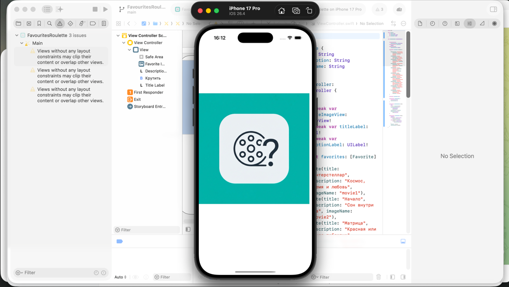
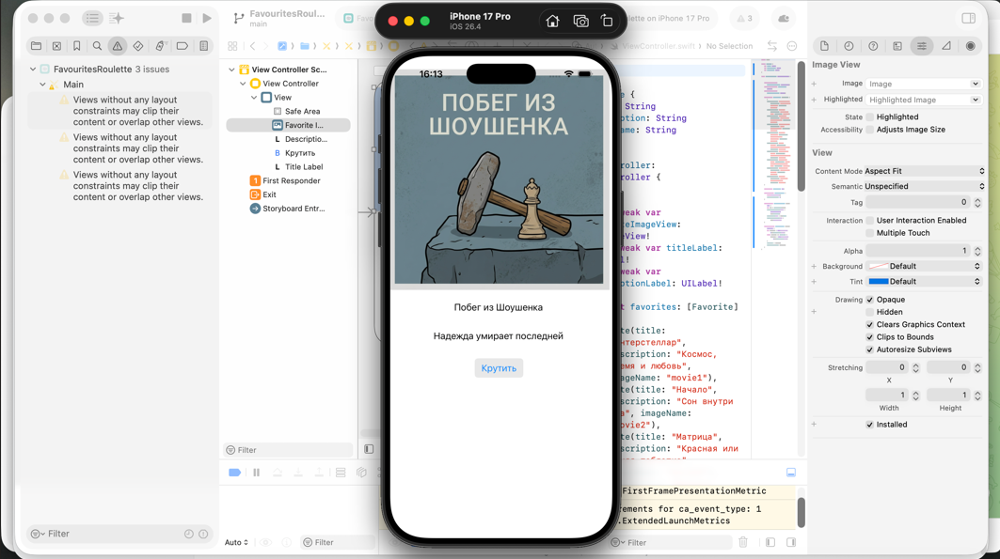
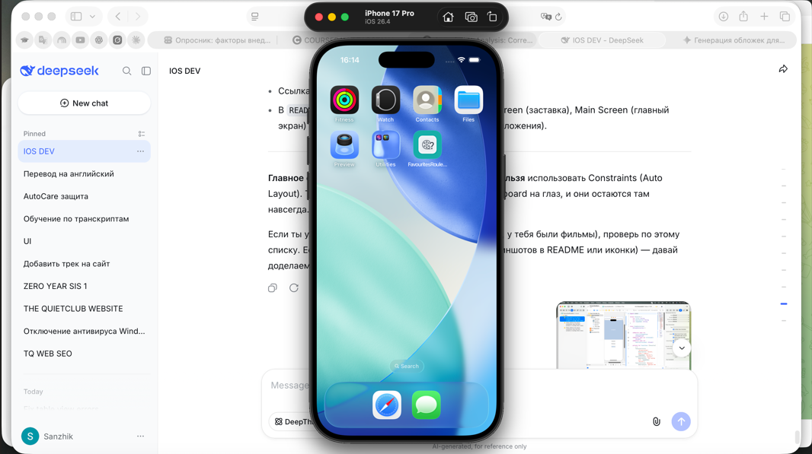

# Favorites Roulette — Lab 6

## Overview
A single-screen iOS app built with UIKit and Storyboard. It shows a random card from a list of 10 favorite movies. Each tap on the button displays a random favorite with an image, title, and short description.

## Screenshots

### Launch Screen

### Main Screen

### Home Screen with App Icon

## How to run
1. Open `FavouritesRoulette.xcodeproj` in Xcode.
2. Select any iPhone Simulator.
3. Press `Cmd + R` to build and run.