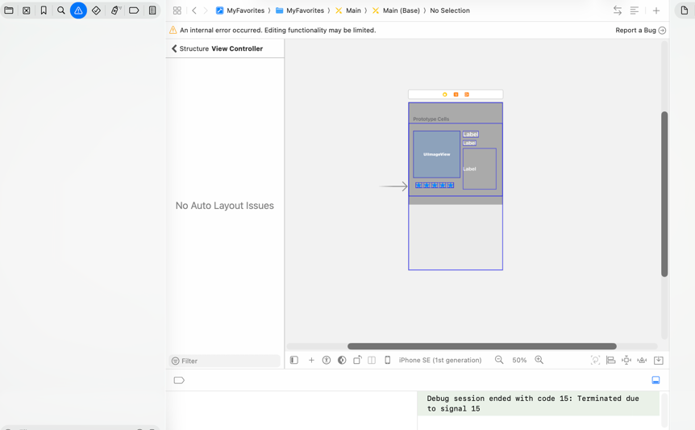
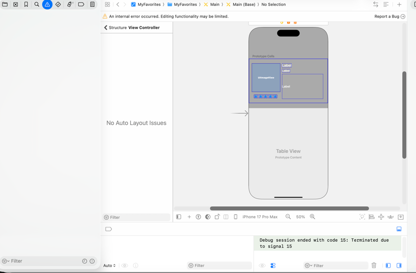

# Favorites List — UITableView & Custom Cells

## Overview
A UIKit app that displays a list of favorite movies and books using a `UITableView` with a custom prototype cell. The cell layout includes an image, title, subtitle, and a rating drawn with 5 SF Symbols stars.

## Requirements Implemented
- **Data Model:** Used a `FavItem` struct with title, subtitle, image name, and rating.
- **Custom Cell:** Created `FavCell` subclass with `@IBOutlet`s.
- **Layout:** Built in `Main.storyboard` inside the prototype cell's content view without using code constraints.
- **Rating:** A row of 5 SF Symbol images (`star.fill` / `star`) showing the item's rating.
- **Sections:** Divided the list into two sections: Movies & Series and Books.
- **No Force Unwraps:** No `!` used outside of `@IBOutlet`s.

## Screenshots

### iPhone SE (3rd generation)

### iPhone 17 Pro Max

## Screen Recording
A short screen recording demonstrating scrolling through the whole list is attached to the repository.
[Watch the demo](Screen_Recording.mp4)